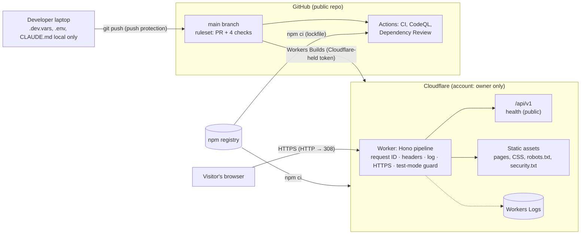

# Threat model

Burn and Churn Coffee is a fictional business; this is a portfolio project. The threat model is written as if the site were real, because that's the skill it demonstrates.

| Version | Date       | Scope                                                                                            | Method                              |
| ------- | ---------- | ------------------------------------------------------------------------------------------------ | ----------------------------------- |
| **v1**  | 2026-11-02 | Phase 0: public pages, the API skeleton, the build and deploy pipeline, the accounts behind them | STRIDE per element of the data flow |

The model is updated whenever a phase adds an attack surface (plan §9). The [planned surfaces](#planned-surfaces) section lists what each later phase adds, so the next version knows where to look.

---

## 1. System as built (Phase 0)

### Trust boundaries

1. **Internet → Worker.** Everything from a browser is untrusted: URL, headers (including `X-Request-Id` and `Origin`), body.
2. **Developer laptop → GitHub.** Pushes are untrusted until checks pass; secrets must never cross.
3. **npm registry → build.** Third-party code entering CI and the Cloudflare build.
4. **GitHub → Cloudflare.** Workers Builds pulls `main` and branches and deploys them.

### Assets worth protecting

| Asset                                                 | Why it matters now                                             | Later                                                        |
| ----------------------------------------------------- | -------------------------------------------------------------- | ------------------------------------------------------------ |
| Site integrity (what visitors see and run)            | Defacement or injected script would be served to every visitor | Customer sessions, checkout redirects                        |
| The honesty guarantees (banner, `noindex`, test mode) | The site must never pass as a real business or take real money | Same                                                         |
| Cloudflare account and build token                    | Full control of what's deployed                                | D1 data, secrets                                             |
| GitHub repository and `main`                          | Source of every deploy                                         | Same                                                         |
| Secrets (none deployed yet)                           | —                                                              | Entra certificate, Stripe test keys, webhook secrets, AI key |
| Availability on the free tier (100,000 requests/day)  | A flood can exhaust the daily quota                            | Same                                                         |

---

## 2. STRIDE by element

Status: **Done** (implemented and tested, with the evidence named) · **Partial** · **Planned** (phase named) · **Accepted** (reasoned, see §3).

### 2.1 Worker request pipeline and static assets

| Threat                     | Example                                                | Control                                                                                                                       | Status             | Evidence                                                               |
| -------------------------- | ------------------------------------------------------ | ----------------------------------------------------------------------------------------------------------------------------- | ------------------ | ---------------------------------------------------------------------- |
| **S**poofing               | Attacker sends `X-Request-Id` to forge log correlation | Request ID always generated server-side, client value ignored                                                                 | Done               | `tests/api/app.test.ts` "ignores one sent by the client"               |
| **T**ampering              | Content injected over plain HTTP on first visit        | 308 to HTTPS for non-loopback `http:`; HSTS 1 year                                                                            | Done               | ADR-0005; live check 2026-11-02                                        |
| Tampering                  | Injected script runs in visitors' browsers             | CSP `script-src 'self'` (no inline), `object-src 'none'`, `base-uri 'none'`; Astro output encoding; `set:html` banned by lint | Done               | `tests/e2e/headers.spec.ts`; ESLint rule `astro/no-set-html-directive` |
| Tampering                  | Clickjacking the site in a frame                       | `frame-ancestors 'none'`, `X-Frame-Options: DENY`                                                                             | Done               | headers e2e                                                            |
| Tampering                  | Static files served without protections                | Worker runs first for every request (`run_worker_first`, custom entry)                                                        | Done               | ADR-0003; e2e checks CSS and `robots.txt`                              |
| **R**epudiation            | No record of what happened                             | JSON request log (ID, method, path, status, timing) to Workers Logs                                                           | Partial            | Insert-only `audit_log` for privileged actions in Phase 2              |
| **I**nformation disclosure | Error responses leak internals                         | RFC 9457 problems with no detail; only the error class logged                                                                 | Done               | `tests/api/app.test.ts` "500 problem without internal details"         |
| Information disclosure     | Logs capture secrets or personal data                  | Log excludes query strings, cookies, bodies; env errors name variables only                                                   | Done               | `src/server/app.ts`; ADR-0006                                          |
| Information disclosure     | Referrer leaks full URLs                               | `Referrer-Policy: strict-origin-when-cross-origin`                                                                            | Done               | headers e2e                                                            |
| **D**enial of service      | Request flood exhausts the free daily quota            | Cloudflare's network-level DDoS protection; no rate limits yet                                                                | Accepted (Phase 0) | Rate limits on `/api` planned with the first state-changing route      |
| DoS                        | Large request bodies                                   | 16 KB body limit on `/api`                                                                                                    | Done               | `tests/api/app.test.ts` "oversized body"                               |
| **E**levation of privilege | Reaching a route without authorization                 | Deny by default; every route declares a principal; unknown routes 404                                                         | Done               | "every route declares a principal" test; ADR-0007                      |

### 2.2 API (`/api/v1`)

| Threat                 | Example                                        | Control                                                                                        | Status                                   | Evidence                                             |
| ---------------------- | ---------------------------------------------- | ---------------------------------------------------------------------------------------------- | ---------------------------------------- | ---------------------------------------------------- |
| Spoofing               | Cross-site request forgery from another origin | `Origin` must equal the site's origin on POST/PUT/PATCH/DELETE; cookies will be `SameSite=Lax` | Done                                     | CSRF tests (no Origin, evil Origin → 403)            |
| Spoofing               | Staff and customer sessions confused           | Staff routes require workforce sign-in **and** a role                                          | Partial (logic tested; sessions Phase 2) | `tests/unit/authz.test.ts`                           |
| Information disclosure | Cross-origin reads of API data                 | No CORS headers anywhere                                                                       | Done                                     | headers e2e asserts no `Access-Control-Allow-Origin` |
| Information disclosure | API responses cached by intermediaries         | `Cache-Control: no-store`                                                                      | Done                                     | API tests                                            |

### 2.3 Honesty guarantees

| Threat                        | Example                                   | Control                                                                                | Status | Evidence                                                   |
| ----------------------------- | ----------------------------------------- | -------------------------------------------------------------------------------------- | ------ | ---------------------------------------------------------- |
| Spoofing (of a real business) | Site mistaken for a real café, or indexed | Non-dismissible banner on every page; `noindex` meta and header; `robots.txt` disallow | Done   | `tests/e2e/honesty.spec.ts`                                |
| Tampering (real money)        | A live Stripe key configured by mistake   | Test-mode guard: every path returns 503; `check-env` fails                             | Done   | ADR-0006; guard tests; live-key check on the local runtime |

### 2.4 Source, build and deploy

| Threat                 | Example                                       | Control                                                                                                       | Status  | Evidence                                                      |
| ---------------------- | --------------------------------------------- | ------------------------------------------------------------------------------------------------------------- | ------- | ------------------------------------------------------------- |
| Spoofing               | Someone else pushes to the repo               | Sole collaborator; GitHub account 2FA (hub record)                                                            | Done    | Repository settings                                           |
| Tampering              | Unreviewed or failing code reaches `main`     | Ruleset: PR required, 4 checks required, no force-push or deletion                                            | Done    | ADR-0009                                                      |
| Tampering              | Malicious npm release                         | Exact pins, lockfile, `npm ci`, 7-day age rule, Dependency Review, `npm audit`, Dependabot                    | Done    | ADR-0008                                                      |
| Tampering              | A GitHub Action's tag moved to malicious code | Every action pinned to a full commit SHA                                                                      | Done    | `.github/workflows/*`                                         |
| Tampering              | Workflow token abused                         | Read-only default permissions; `persist-credentials: false`                                                   | Done    | workflows                                                     |
| Information disclosure | Secret committed to the repo                  | Push protection; `.gitignore` for `.env`, `.dev.vars`, keys, `CLAUDE.md`; staged-diff scan before each commit | Partial | Owner's push-protection test (Phase 0 checklist) still to run |
| Information disclosure | Personal or tenant identifiers published      | Planning file kept local and removed from history; identifiers only in git-ignored env files                  | Done    | Repo history (PR #1)                                          |
| Elevation of privilege | Stolen Cloudflare token deploys anything      | Token held by Cloudflare, not GitHub; dedicated to this project; listed in the secrets inventory              | Done    | ADR-0010; `docs/secrets-inventory.md`                         |
| Elevation of privilege | Cloudflare account takeover                   | Owner-only account; 2FA                                                                                       | Done    | Owner confirmed Cloudflare account 2FA on 2026-11-02          |

---

## 3. Accepted risks (Phase 0)

| Risk                                                                        | Why accepted                                                                                | Revisit                                                     |
| --------------------------------------------------------------------------- | ------------------------------------------------------------------------------------------- | ----------------------------------------------------------- |
| No rate limiting on `/api`                                                  | Only a read-only health route exists; Cloudflare absorbs network floods                     | With the first state-changing route (Phase 2)               |
| 11 moderate `npm audit` findings (one `minimatch` advisory) in lint tooling | Dev-only, never processes untrusted input; fix needs a major version ESLint doesn't support | When Dependabot offers the fix                              |
| Shared `workers.dev` domain                                                 | Free tier; HSTS covers this host only; no cookies yet                                       | Before customer sign-in (Phase 5), consider a custom domain |
| `wrangler preview` is an open-beta feature                                  | Preview builds aren't production                                                            | If it changes, use `wrangler versions upload` (ADR-0010)    |

---

## 4. Planned surfaces

What each later phase adds, so the next version of this model starts from a list:

| Phase | New surface                                                        | Main threats to model                                                                                                           |
| ----- | ------------------------------------------------------------------ | ------------------------------------------------------------------------------------------------------------------------------- |
| 1     | Images, fonts, the menu dialog script, hero video                  | CSP coverage for media; third-party asset provenance; performance as availability                                               |
| 2     | Staff sign-in (Entra ID, OIDC + PKCE), sessions in D1, `audit_log` | Session fixation and theft, token handling, shared counter tablet left signed in, role mapping errors, preview vs production D1 |
| 3     | Register, order board, 86, cash                                    | Privilege misuse, separation of duties on refunds, insider fraud, audit gaps                                                    |
| 4     | Stripe Terminal (simulated reader), webhooks                       | Webhook spoofing and replay, live/test key confusion, reader spoofing                                                           |
| 5     | Customer accounts (Entra External ID), Stripe Checkout             | Account takeover, price tampering, cross-customer data access, delete-my-data                                                   |
| 7     | Microsoft Graph with `Sites.Selected`, SharePoint sync             | Over-broad Graph permission, certificate theft, malicious list content (stored XSS)                                             |
| 8     | AI order helper                                                    | Prompt injection, data leakage, cost exhaustion (OWASP Top 10 for LLM Applications)                                             |
