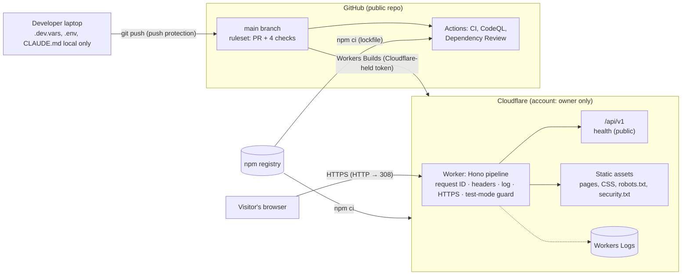

# Threat model

Burn and Churn Coffee is a fictional business; this is a portfolio project. The threat model is written as if the site were real, because that's the skill it demonstrates.

| Version  | Date       | Scope                                                                                                                                                                                                               | Method                                                                           |
| -------- | ---------- | ------------------------------------------------------------------------------------------------------------------------------------------------------------------------------------------------------------------- | -------------------------------------------------------------------------------- |
| **v1**   | 2026-11-02 | Phase 0: public pages, the API skeleton, the build and deploy pipeline, the accounts behind them                                                                                                                    | STRIDE per element of the data flow                                              |
| **v1.1** | 2026-11-04 | Phase 1 additions: self-hosted fonts, images and video, two page scripts, menu dialogs, caching, log redaction, error and maintenance pages                                                                         | Same; see §4                                                                     |
| **v1.2** | 2026-11-07 | Phase 2 additions: staff sign-in with Entra ID, sessions, the audit log, the first staff route and pages                                                                                                            | Same; see §4a                                                                    |
| **v1.3** | 2026-11-07 | Phase 2 close-out: session timeout warning and its two routes, hourly clean-up job                                                                                                                                  | Same; see §4a                                                                    |
| **v1.4** | 2026-11-07 | Repository audit: statuses brought up to date with the live sign-in; an overdue accepted risk (rate limits) reopened                                                                                                | Review against code, tests and evidence (`docs/evidence/2026-11-07-repo-audit/`) |
| **v1.5** | 2026-11-07 | Rate limits on `/api/v1` (ADR-0029): closes the threat reopened in v1.4                                                                                                                                             | Same; see §2.1                                                                   |
| **v1.6** | 2026-11-07 | No anonymous request writes to D1 (ADR-0030): sign-in attempts in a sealed cookie; refusals before identification logged, not audited. The rate limiter is attached but not enforced by Cloudflare today (ADR-0029) | Same; see §2.1 and §4a                                                           |
| **v1.7** | 2026-11-08 | Phase 3, first part: the register (cash sales), the order board, shared-tablet sessions (ADR-0031)                                                                                                                  | Same; see §4b                                                                    |
| **v1.8** | 2026-11-08 | Phase 3, second part: 86 an item, restock requests, the staff activity feed (ADR-0032)                                                                                                                              | Same; see §4b                                                                    |
| **v1.9** | 2026-11-08 | The restock chain (ADR-0033): sold out by anyone, restock requested by Shift Lead+, approved by another Manager+, received by Shift Lead+; undo and override; restock history                                       | Same; see §4b                                                                    |
| **v2.0** | 2026-11-09 | Phase 3, last part: refunds with separation of duties, the cash drawer with a blind count, fixed reason lists (ADR-0034)                                                                                            | Same; see §4b                                                                    |
| **v2.1** | 2026-11-09 | Phase 4, first part: the Stripe library, keys, the set-up script and the signed webhook endpoint (ADR-0035)                                                                                                         | Same; see §4c                                                                    |
| **v2.2** | 2026-11-09 | Phase 4, second part: card payments at the counter through the simulated reader (ADR-0036)                                                                                                                          | Same; see §4c                                                                    |
| **v2.3** | 2026-11-09 | Phase 4, last part: card refunds through Stripe (ADR-0037)                                                                                                                                                          | Same; see §4c                                                                    |
| **v2.4** | 2026-11-10 | Trial prep (Phase 6, ADR-0038): the SharePoint contract, the sync app with per-list read, Conditional Access and device compliance, set-up scripts                                                                  | Same; see §5 (Phase 7 row)                                                       |
| **v2.5** | 2026-11-11 | Phase 7, first part: the SharePoint sync, its cron and the Publish page (ADR-0039)                                                                                                                                  | Same; see §4d                                                                    |
| **v2.6** | 2026-11-11 | Phase 5, first part: strict rate limits in a Durable Object on sign-in, Stripe and Graph routes (ADR-0040); closes the accepted "card routes called in a loop"                                                      | Same; see §2.1 and §4c                                                           |
| **v2.7** | 2026-11-13 | Phase 5, second part: customer sign-in with Entra External ID (ADR-0042), the account page; the accepted "shared `workers.dev` domain" revisited at its trigger                                                     | Same; see §4e and §3                                                             |
| **v2.8** | 2026-11-13 | Phase 5, third part: Delete my data with the erasure app (ADR-0043)                                                                                                                                                 | Same; see §4e                                                                    |
| **v2.9** | 2026-11-14 | Phase 5, fourth part: the cart (browser storage) and the public menu endpoint                                                                                                                                       | Same; see §4e                                                                    |
| **v3.0** | 2026-11-14 | Phase 5, last part: online orders through Stripe Checkout (ADR-0044)                                                                                                                                                | Same; see §4e                                                                    |

The model is updated whenever a phase adds an attack surface (plan §9). The [planned surfaces](#5-planned-surfaces) section lists what each later phase adds, so the next version knows where to look.

---

## 1. System as built (Phase 0)

### Trust boundaries

1. **Internet → Worker.** Everything from a browser is untrusted: URL, headers (including `X-Request-Id` and `Origin`), body.
2. **Developer laptop → GitHub.** Pushes are untrusted until checks pass; secrets must never cross.
3. **npm registry → build.** Third-party code entering CI and the Cloudflare build.
4. **GitHub → Cloudflare.** Workers Builds pulls `main` and branches and deploys them.

### Assets worth protecting

| Asset                                                 | Why it matters now                                             | Later                                                        |
| ----------------------------------------------------- | -------------------------------------------------------------- | ------------------------------------------------------------ |
| Site integrity (what visitors see and run)            | Defacement or injected script would be served to every visitor | Customer sessions, checkout redirects                        |
| The honesty guarantees (banner, `noindex`, test mode) | The site must never pass as a real business or take real money | Same                                                         |
| Cloudflare account and build token                    | Full control of what's deployed                                | D1 data, secrets                                             |
| GitHub repository and `main`                          | Source of every deploy                                         | Same                                                         |
| Secrets (none deployed yet)                           | —                                                              | Entra certificate, Stripe test keys, webhook secrets, AI key |
| Availability on the free tier (100,000 requests/day)  | A flood can exhaust the daily quota                            | Same                                                         |

---

## 2. STRIDE by element

Status: **Done** (implemented and tested, with the evidence named) · **Partial** · **Planned** (phase named) · **Accepted** (reasoned, see §3).

### 2.1 Worker request pipeline and static assets

| Threat                     | Example                                                                                 | Control                                                                                                                                                                                                                                                                                                                                                                                                                                                                   | Status                                                                  | Evidence                                                                                                             |
| -------------------------- | --------------------------------------------------------------------------------------- | ------------------------------------------------------------------------------------------------------------------------------------------------------------------------------------------------------------------------------------------------------------------------------------------------------------------------------------------------------------------------------------------------------------------------------------------------------------------------- | ----------------------------------------------------------------------- | -------------------------------------------------------------------------------------------------------------------- |
| **S**poofing               | Attacker sends `X-Request-Id` to forge log correlation                                  | Request ID always generated server-side, client value ignored                                                                                                                                                                                                                                                                                                                                                                                                             | Done                                                                    | `tests/api/app.test.ts` "ignores one sent by the client"                                                             |
| **T**ampering              | Content injected over plain HTTP on first visit                                         | 308 to HTTPS for non-loopback `http:`; HSTS 1 year                                                                                                                                                                                                                                                                                                                                                                                                                        | Done                                                                    | ADR-0005; live check 2026-11-02                                                                                      |
| Tampering                  | Injected script runs in visitors' browsers                                              | CSP `script-src 'self'` (no inline), `object-src 'none'`, `base-uri 'none'`; Astro output encoding; `set:html` banned by lint                                                                                                                                                                                                                                                                                                                                             | Done                                                                    | `tests/e2e/headers.spec.ts`; ESLint rule `astro/no-set-html-directive`                                               |
| Tampering                  | Clickjacking the site in a frame                                                        | `frame-ancestors 'none'`, `X-Frame-Options: DENY`                                                                                                                                                                                                                                                                                                                                                                                                                         | Done                                                                    | headers e2e                                                                                                          |
| Tampering                  | Static files served without protections                                                 | Worker runs first for every request (`run_worker_first`, custom entry)                                                                                                                                                                                                                                                                                                                                                                                                    | Done                                                                    | ADR-0003; e2e checks CSS and `robots.txt`                                                                            |
| **R**epudiation            | No record of what happened                                                              | JSON request log (ID, method, path, status, timing) to Workers Logs; insert-only `audit_log` for sign-in, sign-out and refusals (privileged actions as they arrive)                                                                                                                                                                                                                                                                                                       | Done                                                                    | `tests/api/app.test.ts`; `tests/db/session.test.ts` "audit log (AU-9)"                                               |
| **I**nformation disclosure | Error responses leak internals                                                          | RFC 9457 problems with no detail; only the error class logged                                                                                                                                                                                                                                                                                                                                                                                                             | Done                                                                    | `tests/api/app.test.ts` "500 problem without internal details"                                                       |
| Information disclosure     | Logs capture secrets or personal data                                                   | Log excludes query strings, cookies, bodies; env errors name variables only                                                                                                                                                                                                                                                                                                                                                                                               | Done                                                                    | `src/server/app.ts`; ADR-0006                                                                                        |
| Information disclosure     | Referrer leaks full URLs                                                                | `Referrer-Policy: strict-origin-when-cross-origin`                                                                                                                                                                                                                                                                                                                                                                                                                        | Done                                                                    | headers e2e                                                                                                          |
| **D**enial of service      | Request flood exhausts the free daily quota; scripted sign-ins use up D1's daily writes | No anonymous request writes to D1 (ADR-0030), so floods cost requests, not database writes; Cloudflare's network-level DDoS protection; a per-IP rate limiter in the code (ADR-0029), attached but **not enforced by Cloudflare on this account today** ([Cloudflare issue](https://github.com/cloudflare/developer-platform/issues/123), first filed as workers-sdk #16097); strict per-caller limits in a Durable Object on sign-in, Stripe and Graph routes (ADR-0040) | Done for D1 writes; strict limits Lab-verified in production 2026-11-11 | "writes nothing to the database" and the refusal tests (`tests/api/staff-auth.test.ts`); ADR-0029 verification table |
| DoS                        | Large request bodies                                                                    | 16 KB body limit on `/api`                                                                                                                                                                                                                                                                                                                                                                                                                                                | Done                                                                    | `tests/api/app.test.ts` "oversized body"                                                                             |
| **E**levation of privilege | Reaching a route without authorization                                                  | Deny by default; every route declares a principal; unknown routes 404                                                                                                                                                                                                                                                                                                                                                                                                     | Done                                                                    | "every route declares a principal" test; ADR-0007                                                                    |

### 2.2 API (`/api/v1`)

| Threat                 | Example                                        | Control                                                                                        | Status | Evidence                                                                                  |
| ---------------------- | ---------------------------------------------- | ---------------------------------------------------------------------------------------------- | ------ | ----------------------------------------------------------------------------------------- |
| Spoofing               | Cross-site request forgery from another origin | `Origin` must equal the site's origin on POST/PUT/PATCH/DELETE; cookies will be `SameSite=Lax` | Done   | CSRF tests (no Origin, evil Origin → 403)                                                 |
| Spoofing               | Staff and customer sessions confused           | Staff routes require workforce sign-in **and** a role                                          | Done   | `tests/unit/authz.test.ts`; "refuses a customer session" (`tests/api/staff-auth.test.ts`) |
| Information disclosure | Cross-origin reads of API data                 | No CORS headers anywhere                                                                       | Done   | headers e2e asserts no `Access-Control-Allow-Origin`                                      |
| Information disclosure | API responses cached by intermediaries         | `Cache-Control: no-store`                                                                      | Done   | API tests                                                                                 |

### 2.3 Honesty guarantees

| Threat                        | Example                                   | Control                                                                                | Status | Evidence                                                   |
| ----------------------------- | ----------------------------------------- | -------------------------------------------------------------------------------------- | ------ | ---------------------------------------------------------- |
| Spoofing (of a real business) | Site mistaken for a real café, or indexed | Non-dismissible banner on every page; `noindex` meta and header; `robots.txt` disallow | Done   | `tests/e2e/honesty.spec.ts`                                |
| Tampering (real money)        | A live Stripe key configured by mistake   | Test-mode guard: every path returns 503; `check-env` fails                             | Done   | ADR-0006; guard tests; live-key check on the local runtime |

### 2.4 Source, build and deploy

| Threat                 | Example                                       | Control                                                                                                       | Status | Evidence                                                                                                                                                                                   |
| ---------------------- | --------------------------------------------- | ------------------------------------------------------------------------------------------------------------- | ------ | ------------------------------------------------------------------------------------------------------------------------------------------------------------------------------------------ |
| Spoofing               | Someone else pushes to the repo               | Sole collaborator; GitHub account 2FA (hub record)                                                            | Done   | Repository settings                                                                                                                                                                        |
| Tampering              | Unreviewed or failing code reaches `main`     | Ruleset: PR required, 4 checks required, no force-push or deletion                                            | Done   | ADR-0009                                                                                                                                                                                   |
| Tampering              | Malicious npm release                         | Exact pins, lockfile, `npm ci`, 7-day age rule, Dependency Review, `npm audit`, Dependabot                    | Done   | ADR-0008                                                                                                                                                                                   |
| Tampering              | A GitHub Action's tag moved to malicious code | Every action pinned to a full commit SHA                                                                      | Done   | `.github/workflows/*`                                                                                                                                                                      |
| Tampering              | Workflow token abused                         | Read-only default permissions; `persist-credentials: false`                                                   | Done   | workflows                                                                                                                                                                                  |
| Information disclosure | Secret committed to the repo                  | Push protection; `.gitignore` for `.env`, `.dev.vars`, keys, `CLAUDE.md`; staged-diff scan before each commit | Done   | Secret scanning and push protection confirmed enabled through the GitHub API, 2026-11-02. A blocked test push was not performed (owner's choice); the control is configured, not exercised |
| Information disclosure | Personal or tenant identifiers published      | Planning file kept local and removed from history; identifiers only in git-ignored env files                  | Done   | Repo history (PR #1)                                                                                                                                                                       |
| Elevation of privilege | Stolen Cloudflare token deploys anything      | Token held by Cloudflare, not GitHub; dedicated to this project; listed in the secrets inventory              | Done   | ADR-0010; `docs/secrets-inventory.md`                                                                                                                                                      |
| Elevation of privilege | Cloudflare account takeover                   | Owner-only account; 2FA                                                                                       | Done   | Owner confirmed Cloudflare account 2FA on 2026-11-02                                                                                                                                       |

---

## 3. Accepted risks (Phase 0)

| Risk                                                                            | Why accepted                                                                                                                                                                                                                                                                                                                                                                                                                                                    | Revisit                                                                         |
| ------------------------------------------------------------------------------- | --------------------------------------------------------------------------------------------------------------------------------------------------------------------------------------------------------------------------------------------------------------------------------------------------------------------------------------------------------------------------------------------------------------------------------------------------------------- | ------------------------------------------------------------------------------- |
| ~~No rate limiting on `/api`~~                                                  | **Expired, not revisited:** the revisit point (the first state-changing route) arrived with Phase 2 on 2026-11-07 and was missed; found by the repository audit the same day. **Closed** by ADR-0029 (rate limits), v1.5                                                                                                                                                                                                                                        | —                                                                               |
| ~~11 moderate `npm audit` findings (one `minimatch` advisory) in lint tooling~~ | **Resolved 2026-11-02:** minimatch overridden to 11.0.1; `npm audit` reports 0 (ADR-0016)                                                                                                                                                                                                                                                                                                                                                                       | Remove the override when ESLint depends on minimatch 11                         |
| Shared `workers.dev` domain                                                     | Free tier; HSTS covers this host only. **Revisited at its trigger (customer sign-in), 2026-11-13, and kept:** `workers.dev` is on the Public Suffix List (checked 2026-11-13), so browsers treat each `*.workers.dev` Worker as its own site: another Worker can't set cookies for this one, and `SameSite` counts it as cross-site. Every cookie also uses the `__Host-` prefix (host-only, `Secure`, `Path=/`). A custom domain would add nothing for cookies | If a custom domain is added for other reasons, or `workers.dev` leaves the list |
| `wrangler preview` is an open-beta feature                                      | Preview builds aren't production                                                                                                                                                                                                                                                                                                                                                                                                                                | If it changes, use `wrangler versions upload` (ADR-0010)                        |

---

## 4. Phase 1 additions (v1.1, 2026-11-04)

| Element                                          | Threat                                               | Control                                                                                                        | Status | Evidence                                                 |
| ------------------------------------------------ | ---------------------------------------------------- | -------------------------------------------------------------------------------------------------------------- | ------ | -------------------------------------------------------- |
| Fonts, images, video                             | Tampering or tracking through third-party assets     | All self-hosted; CSP `default-src 'self'`; no third-party requests on any page                                 | Done   | `tests/e2e/info-pages.spec.ts` "no third-party requests" |
| Page scripts (`hero-video.js`, `menu-dialog.js`) | Injected or inline script                            | External files under `script-src 'self'`; no inline script; menu works without JS (ADR-0013)                   | Done   | headers e2e "no CSP violations"                          |
| Menu dialogs                                     | Content injection from menu data                     | Data validated by zod at build; Astro escapes text; `set:html` banned by lint                                  | Done   | `tests/unit/menu.test.ts`                                |
| Caching (ADR-0020)                               | Stale or cached private responses                    | Long cache only for static files under `/fonts/`, `/images/`, `/media/`, `/scripts/`; pages and API not cached | Done   | `tests/unit/cache-policy.test.ts`                        |
| Request logs (ADR-0021)                          | Information disclosure through logged URLs           | Query strings redacted from Cloudflare's logs; our log line has none; 3-day retention                          | Done   | `wrangler.jsonc`; privacy page                           |
| Error pages (ADR-0022)                           | Information disclosure in errors                     | Branded 500 page for people, problem details for the API, no internals                                         | Done   | `tests/api/maintenance.test.ts`                          |
| Maintenance switch (ADR-0022)                    | Availability during an incident; a deploy undoing it | Secret-based switch, survives deploys; invalid values stop the site                                            | Done   | runbook; `tests/api/maintenance.test.ts`                 |
| Preview deploys (ADR-0020)                       | A preview mistaken for production                    | `APP_ENV=preview` via the `previews` block; health check reports it                                            | Done   | verified on a preview URL, 2026-11-04                    |

## 4a. Phase 2 additions (v1.2, 2026-11-07)

Staff sign-in (ADR-0024, ADR-0025, ADR-0027). Status "Built" means coded and tested against a stubbed Entra; "Done" also needs Michael's live test with the tenant. The first live sign-in (barista, production, 2026-11-07, `docs/evidence/2026-11-07-staff-sign-in/`) moved the sign-in flow and session rows to Done.

| Element                                      | Threat                                                                                       | Control                                                                                                                                                                                                                              | Status               | Evidence                                                                                                                       |
| -------------------------------------------- | -------------------------------------------------------------------------------------------- | ------------------------------------------------------------------------------------------------------------------------------------------------------------------------------------------------------------------------------------ | -------------------- | ------------------------------------------------------------------------------------------------------------------------------ |
| Sign-in start (`/auth/staff/login`)          | Login CSRF (an attacker signs the victim in as the attacker); D1 writes by anyone            | State, PKCE verifier and nonce sealed with AES-256-GCM in a `__Host-` cookie bound to the browser; the callback must match it; nothing written to D1 (ADR-0030)                                                                      | Done                 | "writes nothing to the database", "an altered login cookie", "state that does not match"; live sign-in 2026-11-07 (old design) |
| Callback (`/auth/staff/callback`)            | Code interception or replay                                                                  | PKCE (S256); Entra redeems each code once; the sealed attempt expires after 10 minutes and is cleared on use; codes kept out of logs (ADR-0021)                                                                                      | Done                 | "a replayed callback is refused", "more than 10 minutes old"                                                                   |
| ID token                                     | Forged or substituted token                                                                  | Token taken only from Entra's token endpoint over TLS; issuer, audience, expiry and nonce checked by oauth4webapi; tenant and object ID checked by the site                                                                          | Done                 | "nonce does not match", "another tenant"; live sign-in 2026-11-07                                                              |
| Client credential                            | Stolen secret used to impersonate the app                                                    | No client secret; certificate assertion (`private_key_jwt`, `x5t`); key outside the repo; expiry tracked                                                                                                                             | Done                 | "a certificate assertion, no secret"; secrets inventory; live sign-in 2026-11-07                                               |
| Roles                                        | A person without a role gets in; wrong role mapping                                          | Entra "Assignment required"; site refuses a token without a staff role; highest role wins; role fixed at sign-in. **Open finding 2026-11-07:** Entra issued a token to an account with no role; the site's own check refused it      | Built (finding open) | `tests/unit/entra.test.ts`; evidence 2026-11-07 (both folders)                                                                 |
| Sessions                                     | Fixation, theft, a tablet left signed in                                                     | New token per sign-in, stored hashed; `HttpOnly; Secure; SameSite=Lax`; 8 h absolute, 1 h idle, with a warning and "Stay signed in" (ADR-0028); sign-out is a POST behind the Origin check; switch-user forces a fresh Entra sign-in | Done                 | `tests/db/session.test.ts`; logout tests; `tests/e2e/staff-timeout.spec.ts`; live sign-in 2026-11-07                           |
| Session status and extend (`/staff/session`) | A polling page keeps a session alive forever; a cross-site request extends someone's session | The status route reads without moving the idle limit; extend is a POST behind the Origin check; both Barista and up; the 8-hour limit can't be extended                                                                              | Built                | "reports the time left without counting as activity"; CSRF test                                                                |
| Expired rows in D1                           | Old session hashes kept longer than needed                                                   | Hourly Cron Trigger deletes expired sessions (and anything left in the retired `oidc_logins` table); logs counts only; never touches the audit log                                                                                   | Built                | "scheduled clean-up" test                                                                                                      |
| Staff pages                                  | A cached personal page; customers reaching staff pages                                       | `/staff/` rendered per request with `no-store`; requires `idp = workforce` and a role                                                                                                                                                | Built                | page code; `/staff/me` authz tests                                                                                             |
| Audit log                                    | Missing or altered records of who signed in; the log flooded by anonymous junk               | Sign-in, sign-out and refusals of accounts Entra vouched for (with a reason code) in the insert-only `audit_log`; refusals before identification in the request log only (ADR-0030)                                                  | Built                | sign-in, refusal and "nothing written" tests                                                                                   |

**Accepted for now:** sign-out ends the site's session but not the person's Entra session; on the shared tablet the next person uses "Sign in as someone else" (`prompt=login`). Register and order-board screens tighten the session to 15 minutes idle (in place since Phase 3, ADR-0031; see §4b).

## 4b. Phase 3 additions (v1.7, 2026-11-08)

The register and the order board (ADR-0031). "Built" means coded and tested; Michael's checklist run makes it Done.

| Element                                       | Threat                                                                                                                                        | Control                                                                                                                                                                                                                                              | Status | Evidence                                                                                                                                              |
| --------------------------------------------- | --------------------------------------------------------------------------------------------------------------------------------------------- | ---------------------------------------------------------------------------------------------------------------------------------------------------------------------------------------------------------------------------------------------------- | ------ | ----------------------------------------------------------------------------------------------------------------------------------------------------- |
| Sale (`POST /staff/orders`)                   | Tampering with prices from the browser                                                                                                        | The browser sends items and quantities only; extra fields are refused; the server prices from the validated menu and stores each line's price                                                                                                        | Built  | "never accepts a price from the browser"                                                                                                              |
| Sale                                          | A double-tap or retry records two sales; someone reads another's sale by its key                                                              | Idempotency key per sale, unique in D1; a key reused by another person gets 409                                                                                                                                                                      | Built  | "a double-tap ... records one sale", "someone else can't use another person's key"                                                                    |
| Sale                                          | Short change, forged amounts                                                                                                                  | Cash handed over must cover the total; change computed on the server; amounts bounded by the schema and by database checks                                                                                                                           | Built  | "refuses ... too little cash"                                                                                                                         |
| Sale                                          | Repudiation: who took this payment?                                                                                                           | `taken_by` on every order (used by the refund rule in PR 3)                                                                                                                                                                                          | Built  | "records the sale ... and who took it"                                                                                                                |
| Board (`/staff/orders`)                       | Two people move one order at once; steps skipped                                                                                              | Moves name the expected stage; one step forward only; conflicts answer 409                                                                                                                                                                           | Built  | "moves them one step at a time; a second tap gets a conflict"                                                                                         |
| Shared counter tablet                         | A tablet left signed in on the register or board                                                                                              | Register screens tighten the session to 15 minutes idle for good; board polling isn't activity; warning in the page and the tab title                                                                                                                | Built  | "sessions on register screens" tests; timeout browser tests                                                                                           |
| Staff pages                                   | Inline script injected into staff pages                                                                                                       | Scripts bundled as external files (`assetsInlineLimit: 0`); strict CSP unchanged                                                                                                                                                                     | Built  | browser test "ring up a cash sale" watches for CSP violations                                                                                         |
| Orders in D1                                  | Kept longer than needed                                                                                                                       | Hourly clean-up deletes orders older than 90 days                                                                                                                                                                                                    | Built  | "deletes orders ... older than 90 days"                                                                                                               |
| Sold out (`/staff/menu/:itemId/availability`) | A drink brought back with no restock behind it; a stale page sells a sold-out item; a mis-tap needs a manager                                 | Anyone marks sold out; back on sale only by a received restock, its marker within 5 minutes, or a Manager+ override with a reason (audited); the sale route prices against current availability                                                      | Built  | "stays sold out across days", "a shift lead is refused; a manager overrides only with a reason", "can't be sold, even from a stale register page"     |
| Restock chain (`/staff/restock/*`)            | One person requests and approves their own order; two managers decide at once; an audit row for a change that lost a race                     | Shift Lead+ requests, Manager+ approves, never their own unless Owner (refusal audited, AC-5); Shift Lead+ receives approved requests only; guarded updates; audit row only if the change happened; one live request per item                        | Built  | "the full chain", "a manager can't decide their own request", "two managers approving at once"                                                        |
| Activity feed                                 | A barista reads managers' actions; history hidden by a promotion                                                                              | Visibility from the role recorded at the time: own rows plus roles below; Owner all; every value bound in SQL                                                                                                                                        | Built  | "each role sees exactly what the rule allows"                                                                                                         |
| Refunds (`POST /staff/orders/:id/refunds`)    | A manager refunds their own sale to pocket the cash; refunds more than was paid; a double-tap refunds twice; two managers over-refund at once | Manager+ only; never the person who took the payment unless Owner, refusal audited (AC-5); amounts from the sale's lines, never typed; a trigger refuses any line beyond what was sold (aborts the refund); idempotency key per refund; confirm step | Built  | "a manager who took the payment is refused", "never more than was sold", "two managers refunding the last drink at once", "the same key refunds once" |
| Cash drawer (`/staff/cash/*`)                 | A short drawer hidden by recounting until it matches; a lead reviews their own shortfall; sales taken with no drawer open                     | Blind count (expected shown only after saving; no recount); over $5 needs a listed reason; reviewed by a Manager+ who didn't close it (unless Owner), refusal audited; sales outside a drawer counted and shown                                      | Built  | "off by more than $5", "flags cash sales taken with no drawer open"                                                                                   |
| Reasons                                       | Free-text reasons that can't be counted, or that carry personal details or abuse into the audit log                                           | Fixed lists per action; only listed codes accepted; Other needs a short note (200 characters)                                                                                                                                                        | Built  | `tests/unit/reasons.test.ts`                                                                                                                          |
| Audit integrity                               | A sale or change recorded without its audit row, or the reverse                                                                               | The change and its audit row in one D1 batch (one transaction); the audit log stays insert-only                                                                                                                                                      | Built  | sale audit row test; `tests/db/session.test.ts` "audit log (AU-9)"                                                                                    |

## 4c. Phase 4 additions (v2.1, 2026-11-09)

Stripe in test mode (ADR-0035). "Built" means coded and tested; Michael's checks make it Done.

| Element                                                     | Threat                                                                                                                                                                       | Control                                                                                                                                                                                                                                                                                                         | Status  | Evidence                                                                                        |
| ----------------------------------------------------------- | ---------------------------------------------------------------------------------------------------------------------------------------------------------------------------- | --------------------------------------------------------------------------------------------------------------------------------------------------------------------------------------------------------------------------------------------------------------------------------------------------------------- | ------- | ----------------------------------------------------------------------------------------------- |
| Webhook endpoint (`POST /api/v1/webhooks/stripe`)           | Spoofed events (someone posts a fake "payment succeeded"); a captured event replayed; Stripe's retries processed twice; live-mode events in a test project; oversized bodies | Stripe's HMAC over the raw body; 5-minute timestamp tolerance; event ID stored once (replays acknowledged, ignored); live-mode refused; nothing written before the signature checks out; 256 KB limit on this path only                                                                                         | Built   | `tests/api/webhooks-stripe.test.ts`                                                             |
| Origin-check exemption                                      | The exemption widens to other routes, reopening CSRF                                                                                                                         | One exact path, listed explicitly; a test proves other routes still need the Origin                                                                                                                                                                                                                             | Built   | "other API routes still require a same-site Origin"                                             |
| Stripe Worker key                                           | A leaked key moves money or reads customer data                                                                                                                              | Restricted key, custom permissions only (no customers, payouts, billing, Connect, webhook management); test mode enforced in three places; never in the repo, chat or logs                                                                                                                                      | Built   | ADR-0035; `docs/secrets-inventory.md`                                                           |
| Set-up key and script                                       | A powerful key left lying around; the webhook secret shown on screen or in logs; a live key used by mistake                                                                  | A separate short-lived key typed at a hidden prompt and deleted after one run; the signing secret piped into `wrangler secret put` without display; live keys and non-simulated readers refused                                                                                                                 | Built   | `scripts/stripe/setup-test.mjs`, `docs/runbooks/stripe-setup.md`                                |
| Card payment (`/staff/card-payments/*`)                     | Prices changed in the browser; a double-tap starts two payments; an order created twice (webhook and status check at once); a declined card shows as paid                    | Server prices from the menu; idempotency key per attempt (also sent to Stripe); the order exists only after Stripe says succeeded; a unique index on the PaymentIntent makes it once; declines recorded with Stripe's code                                                                                      | Built   | `tests/api/staff-card.test.ts`; real Stripe test API check 2026-11-09 (ADR-0036)                |
| Simulate tap                                                | Card numbers handled by the site; the test helper used to fake payments in production                                                                                        | The browser sends only approve or decline; the server sends Stripe's published test numbers to a test helper that doesn't exist in live mode; live keys refused (ADR-0035); every tap audited                                                                                                                   | Built   | `tests/unit/terminal.test.ts`; "tap only while waiting"                                         |
| Card refunds (`POST /staff/orders/:id/refunds`, card sales) | A card sale paid back in cash; the payment-taker refunding their own card sale; a refund Stripe refused still counted as refunded; a retry refunding twice at Stripe         | Card sales refund only to the card through Stripe, never from the drawer; separation of duties as for cash (refusal audited, AC-5); recorded pending first so the over-refund trigger holds; Stripe idempotency key per refund; failures marked, audited and their lines released; failed refunds never counted | Built   | `tests/api/staff-card.test.ts` "card refunds"; real Stripe test API check 2026-11-09 (ADR-0037) |
| Stripe as a vendor                                          | Using a payment provider before assessing it (as happened with Cloudflare, V-014)                                                                                            | Assessed 2026-11-10 (VRA-V013): High 16/18, continue with conditions; a day after use, not before as decided (POAM-037). Conditions: current SOC 2 and PCI AOC by 2026-12-10; the company's PCI scope and SAQ type **determined 2026-11-14** (`docs/pci-scope.md`: SAQ A online, SAQ C counter)                 | Partial | Vendor-Risk-Assessment-Lab V-013; hub POAM-037                                                  |
| Rate limiting                                               | Card routes called in a loop                                                                                                                                                 | Staff-only routes behind sign-in and MFA; per-sale idempotency; the site's own Durable Object limiter, 30 Stripe calls a minute per person (ADR-0040; Cloudflare's binding still doesn't enforce, checked 2026-11-11)                                                                                           | Done    | ADR-0040; `tests/api/strict-limit.test.ts`; `docs/evidence/2026-11-11-rate-limit-and-publish/`  |

## 4d. Phase 7 additions (v2.5, 2026-11-11)

The SharePoint sync (ADR-0039). Built and tested against a fake Graph; the real tenant is tested in the trial (T-SP-03, T-SP-06).

| Element                                    | Threat                                                                                          | Control                                                                                                                                                   | Status | Evidence                                                     |
| ------------------------------------------ | ----------------------------------------------------------------------------------------------- | --------------------------------------------------------------------------------------------------------------------------------------------------------- | ------ | ------------------------------------------------------------ |
| Sync app token                             | The certificate's private key leaks and reads SharePoint                                        | Read on five lists only (per-list grant, ADR-0038); key only in Worker secrets and `.dev.vars`; token in memory, never stored or logged                   | Built  | `tests/unit/graph.test.ts`; trial T-SP-03                    |
| Graph paging                               | A tampered `@odata.nextLink` sends the bearer token to another host                             | Next links followed only back to `https://graph.microsoft.com/v1.0/`; at most 20 pages                                                                    | Built  | "refuses a next link that points anywhere but Graph"         |
| List content                               | Stored XSS or nonsense from an editor (or a compromised editor account) reaches the public site | zod on every row against the contract; plain text only, never `set:html`; menu re-checked by the site's own rules; bad rows skipped and shown to managers | Built  | `tests/unit/sharepoint.test.ts`                              |
| Bad publish                                | A mistake empties the menu or hours, or SharePoint is down                                      | A list with nothing valid, or that can't be read, keeps its last good copy                                                                                | Built  | "keeps the last good menu when SharePoint refuses that list" |
| Publish (`POST /staff/sharepoint/publish`) | Anyone below Manager publishes; cross-site request; repeated clicks pile up runs                | Manager+ (authz test); Origin check; one run at a time (409); audited with counts                                                                         | Built  | `tests/api/staff-sharepoint.test.ts`                         |
| Sync error details                         | Graph error text shown on the page leaks internals                                              | Only the status class is shown (403, 404, unreachable); the message is never stored                                                                       | Built  | "reports lists without an ID as not set up"                  |

## 4e. Phase 5 additions (v2.7, 2026-11-13)

Customer sign-in (ADR-0042). Built and tested against a stand-in for the customer directory; the real sign-up is the Owner's test with his own address.

| Element                                   | Threat                                                                                                     | Control                                                                                                                                                                                                                                                                                                               | Status  | Evidence                                                                                      |
| ----------------------------------------- | ---------------------------------------------------------------------------------------------------------- | --------------------------------------------------------------------------------------------------------------------------------------------------------------------------------------------------------------------------------------------------------------------------------------------------------------------- | ------- | --------------------------------------------------------------------------------------------- |
| Customer vs staff identity                | A customer account reaches staff pages, or a staff token is accepted as a customer                         | Separate directory, app, certificate and login cookie; issuer and audience checked per directory; sessions marked `customer` refused by every staff route (and staff sessions by customer routes); no roles from customer tokens                                                                                      | Built   | `tests/api/customer-auth.test.ts` ("a customer session is refused on staff routes")           |
| Customer sign-in flow                     | Login CSRF, code interception, replayed callbacks                                                          | Same server-side flow as staff: PKCE, state, nonce, a sealed login cookie with its own purpose label (a staff one won't open), certificate client authentication, codes redeemed once                                                                                                                                 | Built   | `tests/api/customer-auth.test.ts`; `tests/unit/login-cookie.test.ts`                          |
| Account takeover                          | Password guessing or reuse                                                                                 | No passwords exist: email one-time codes only (user flow `bc-customers-sign-up-sign-in`); `prompt=login` asks for a fresh code at every sign-in, so signing out really signs out on a shared computer                                                                                                                 | Built   | `setup-customer-app.ps1`; "redirects to the customer directory with … a fresh code each time" |
| Sign-up abuse                             | Bots create accounts in bulk and fill the directory or the users table                                     | Sign-in start and callback limited to 20 a minute per IP (ADR-0040); nothing written before the directory vouches for someone. Turnstile on sign-up stays planned (plan §9)                                                                                                                                           | Built   | "writes nothing to the database (ADR-0030)"                                                   |
| Customer data                             | More personal data kept than needed                                                                        | Only the name and the directory's object ID are kept; the email address stays in the directory and is never stored                                                                                                                                                                                                    | Built   | "… name only, no audit row" (asserts the email isn't stored)                                  |
| Delete my data (`POST /account/delete`)   | A customer can't remove their account; someone else erases it (CSRF, a staff session); a half-done erasure | Customer principal only (staff 403); Origin check; a required confirmation; 3 a minute per person; directory account deleted and purged **first**, then the site's rows in one batch; if the directory refuses, nothing is deleted                                                                                    | Built   | `tests/api/customer-account.test.ts`                                                          |
| Erasure app `bc-website-erasure`          | Its key leaks and deletes customer accounts                                                                | Its own app and certificate (not the sign-in one); one permission, `User.DeleteRestore.All` (delete and restore, no read or change); key only in Worker secrets and `.dev.vars`; each erasure logged                                                                                                                  | Built   | ADR-0043; `docs/secrets-inventory.md`                                                         |
| Account page (`/account/`)                | A cached personal page                                                                                     | Rendered per request with `no-store`                                                                                                                                                                                                                                                                                  | Built   | `tests/e2e/account.spec.ts`                                                                   |
| Cart (`localStorage`, `/order/`)          | A tampered cart sets its own prices, injects markup, or grows without limit                                | The cart holds only drink, size and quantity, never a price; every stored value is re-checked (ids by pattern, sizes from a fixed list, quantities 1 to 20, at most 20 lines); rendered with `textContent` only; prices shown come from `GET /menu`, and checkout prices the order again on the server (`priceOrder`) | Built   | `tests/unit/cart.test.ts`; `tests/e2e/order.spec.ts` ("a tampered cart is cleaned up")        |
| Public menu (`GET /api/v1/menu`)          | Scraping or flooding                                                                                       | Read-only, public data (prices are on the menu page anyway); nothing written; covered by the API-wide rate limit                                                                                                                                                                                                      | Built   | `tests/api/menu.test.ts`                                                                      |
| Checkout (`POST /api/v1/checkout`)        | Price tampering; someone else paying for or reading an order; a double-click charging twice                | Customer only (staff 403, signed-out 401); Origin check; `payments` limit; the server prices every line from its own menu and ignores any price sent; sold-out drinks refused; one key per attempt, a repeated key returns the same session; Stripe idempotency key                                                   | Built   | `tests/api/customer-checkout.test.ts`                                                         |
| Order creation (webhook and status check) | A forged "paid" event; an order created twice; an unpaid session becoming an order                         | Signed, replay-checked webhooks (ADR-0035); an order only when Stripe says `paid`; unique PaymentIntent and key on `orders`; the status check asks Stripe itself, never trusts the browser                                                                                                                            | Built   | "by a signed webhook … a replay does nothing"; "never for an unpaid session"                  |
| Order status (`GET /api/v1/checkout/:id`) | One customer reading another's order by guessing an ID                                                     | Random IDs, and the customer's own only (anyone else's is 404, not 403)                                                                                                                                                                                                                                               | Built   | "a customer sees only their own checkout"                                                     |
| Redirect to Stripe                        | An open redirect, or a look-alike payment page                                                             | The browser follows only a URL that starts with `https://checkout.stripe.com/`; "Sign in to pay" carries a fixed `order` flag in the sealed login cookie, never an address from the request                                                                                                                           | Built   | "?next=order comes back to the order; any other next is ignored"                              |
| Bots at checkout                          | Card testing through the payment page                                                                      | Sign-in (email code) required; per-person limit; Stripe's own fraud checks on its page. **Turnstile deferred to Phase 8** (Owner, 2026-11-14)                                                                                                                                                                         | Partial | ADR-0044                                                                                      |

## 5. Planned surfaces

What each later phase adds, so the next version of this model starts from a list:

| Phase | New surface                                                                                                              | Main threats to model                                                                                                                                                                                                                                                                        |
| ----- | ------------------------------------------------------------------------------------------------------------------------ | -------------------------------------------------------------------------------------------------------------------------------------------------------------------------------------------------------------------------------------------------------------------------------------------- |
| 1     | Images, fonts, the menu dialog script, hero video                                                                        | CSP coverage for media; third-party asset provenance; performance as availability                                                                                                                                                                                                            |
| 2     | Staff sign-in (Entra ID, OIDC + PKCE), sessions in D1, `audit_log`                                                       | Session fixation and theft, token handling, shared counter tablet left signed in, role mapping errors, preview vs production D1                                                                                                                                                              |
| 3     | Register, order board, 86, cash                                                                                          | Privilege misuse, separation of duties on refunds, insider fraud, audit gaps                                                                                                                                                                                                                 |
| 4     | Stripe Terminal (simulated reader), webhooks                                                                             | Webhook spoofing and replay, live/test key confusion, reader spoofing                                                                                                                                                                                                                        |
| 5     | Customer accounts (Entra External ID), Stripe Checkout                                                                   | Account takeover, price tampering, cross-customer data access, delete-my-data                                                                                                                                                                                                                |
| 7     | Microsoft Graph with **per-list** `Lists.SelectedOperations.Selected` (app `bc-website-sync`, ADR-0038), SharePoint sync | Over-broad Graph permission (mitigated: six lists, read only, 403 test T-SP-03), certificate theft, malicious list content (stored XSS; plain text only, zod), person data from the User Information List (hashed match, T-SP-05), Conditional Access lock-out (break-glass exclusion first) |
| 8     | AI order helper                                                                                                          | Prompt injection, data leakage, cost exhaustion (OWASP Top 10 for LLM Applications)                                                                                                                                                                                                          |
