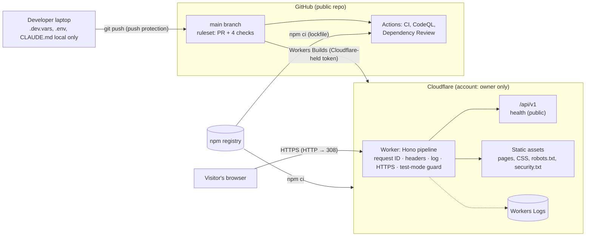

# Threat model

Burn and Churn Coffee is a fictional business; this is a portfolio project. The threat model is written as if the site were real, because that's the skill it demonstrates.

| Version  | Date       | Scope                                                                                                                                       | Method                                                                           |
| -------- | ---------- | ------------------------------------------------------------------------------------------------------------------------------------------- | -------------------------------------------------------------------------------- |
| **v1**   | 2026-11-02 | Phase 0: public pages, the API skeleton, the build and deploy pipeline, the accounts behind them                                            | STRIDE per element of the data flow                                              |
| **v1.1** | 2026-11-04 | Phase 1 additions: self-hosted fonts, images and video, two page scripts, menu dialogs, caching, log redaction, error and maintenance pages | Same; see §4                                                                     |
| **v1.2** | 2026-11-07 | Phase 2 additions: staff sign-in with Entra ID, sessions, the audit log, the first staff route and pages                                    | Same; see §4a                                                                    |
| **v1.3** | 2026-11-07 | Phase 2 close-out: session timeout warning and its two routes, hourly clean-up job                                                          | Same; see §4a                                                                    |
| **v1.4** | 2026-11-07 | Repository audit: statuses brought up to date with the live sign-in; an overdue accepted risk (rate limits) reopened                        | Review against code, tests and evidence (`docs/evidence/2026-11-07-repo-audit/`) |

The model is updated whenever a phase adds an attack surface (plan §9). The [planned surfaces](#5-planned-surfaces) section lists what each later phase adds, so the next version knows where to look.

---

## 1. System as built (Phase 0)

### Trust boundaries

1. **Internet → Worker.** Everything from a browser is untrusted: URL, headers (including `X-Request-Id` and `Origin`), body.
2. **Developer laptop → GitHub.** Pushes are untrusted until checks pass; secrets must never cross.
3. **npm registry → build.** Third-party code entering CI and the Cloudflare build.
4. **GitHub → Cloudflare.** Workers Builds pulls `main` and branches and deploys them.

### Assets worth protecting

| Asset                                                 | Why it matters now                                             | Later                                                        |
| ----------------------------------------------------- | -------------------------------------------------------------- | ------------------------------------------------------------ |
| Site integrity (what visitors see and run)            | Defacement or injected script would be served to every visitor | Customer sessions, checkout redirects                        |
| The honesty guarantees (banner, `noindex`, test mode) | The site must never pass as a real business or take real money | Same                                                         |
| Cloudflare account and build token                    | Full control of what's deployed                                | D1 data, secrets                                             |
| GitHub repository and `main`                          | Source of every deploy                                         | Same                                                         |
| Secrets (none deployed yet)                           | —                                                              | Entra certificate, Stripe test keys, webhook secrets, AI key |
| Availability on the free tier (100,000 requests/day)  | A flood can exhaust the daily quota                            | Same                                                         |

---

## 2. STRIDE by element

Status: **Done** (implemented and tested, with the evidence named) · **Partial** · **Planned** (phase named) · **Accepted** (reasoned, see §3).

### 2.1 Worker request pipeline and static assets

| Threat                     | Example                                                | Control                                                                                                                                                             | Status                      | Evidence                                                                            |
| -------------------------- | ------------------------------------------------------ | ------------------------------------------------------------------------------------------------------------------------------------------------------------------- | --------------------------- | ----------------------------------------------------------------------------------- |
| **S**poofing               | Attacker sends `X-Request-Id` to forge log correlation | Request ID always generated server-side, client value ignored                                                                                                       | Done                        | `tests/api/app.test.ts` "ignores one sent by the client"                            |
| **T**ampering              | Content injected over plain HTTP on first visit        | 308 to HTTPS for non-loopback `http:`; HSTS 1 year                                                                                                                  | Done                        | ADR-0005; live check 2026-11-02                                                     |
| Tampering                  | Injected script runs in visitors' browsers             | CSP `script-src 'self'` (no inline), `object-src 'none'`, `base-uri 'none'`; Astro output encoding; `set:html` banned by lint                                       | Done                        | `tests/e2e/headers.spec.ts`; ESLint rule `astro/no-set-html-directive`              |
| Tampering                  | Clickjacking the site in a frame                       | `frame-ancestors 'none'`, `X-Frame-Options: DENY`                                                                                                                   | Done                        | headers e2e                                                                         |
| Tampering                  | Static files served without protections                | Worker runs first for every request (`run_worker_first`, custom entry)                                                                                              | Done                        | ADR-0003; e2e checks CSS and `robots.txt`                                           |
| **R**epudiation            | No record of what happened                             | JSON request log (ID, method, path, status, timing) to Workers Logs; insert-only `audit_log` for sign-in, sign-out and refusals (privileged actions as they arrive) | Done                        | `tests/api/app.test.ts`; `tests/db/session.test.ts` "audit log (AU-9)"              |
| **I**nformation disclosure | Error responses leak internals                         | RFC 9457 problems with no detail; only the error class logged                                                                                                       | Done                        | `tests/api/app.test.ts` "500 problem without internal details"                      |
| Information disclosure     | Logs capture secrets or personal data                  | Log excludes query strings, cookies, bodies; env errors name variables only                                                                                         | Done                        | `src/server/app.ts`; ADR-0006                                                       |
| Information disclosure     | Referrer leaks full URLs                               | `Referrer-Policy: strict-origin-when-cross-origin`                                                                                                                  | Done                        | headers e2e                                                                         |
| **D**enial of service      | Request flood exhausts the free daily quota            | Cloudflare's network-level DDoS protection; **no rate limits yet**, and the public sign-in start writes a row in D1 on every call                                   | **Open** (audit 2026-11-07) | The Phase 0 acceptance ran out with Phase 2 (§3); a rate limiter is the next change |
| DoS                        | Large request bodies                                   | 16 KB body limit on `/api`                                                                                                                                          | Done                        | `tests/api/app.test.ts` "oversized body"                                            |
| **E**levation of privilege | Reaching a route without authorization                 | Deny by default; every route declares a principal; unknown routes 404                                                                                               | Done                        | "every route declares a principal" test; ADR-0007                                   |

### 2.2 API (`/api/v1`)

| Threat                 | Example                                        | Control                                                                                        | Status | Evidence                                                                                  |
| ---------------------- | ---------------------------------------------- | ---------------------------------------------------------------------------------------------- | ------ | ----------------------------------------------------------------------------------------- |
| Spoofing               | Cross-site request forgery from another origin | `Origin` must equal the site's origin on POST/PUT/PATCH/DELETE; cookies will be `SameSite=Lax` | Done   | CSRF tests (no Origin, evil Origin → 403)                                                 |
| Spoofing               | Staff and customer sessions confused           | Staff routes require workforce sign-in **and** a role                                          | Done   | `tests/unit/authz.test.ts`; "refuses a customer session" (`tests/api/staff-auth.test.ts`) |
| Information disclosure | Cross-origin reads of API data                 | No CORS headers anywhere                                                                       | Done   | headers e2e asserts no `Access-Control-Allow-Origin`                                      |
| Information disclosure | API responses cached by intermediaries         | `Cache-Control: no-store`                                                                      | Done   | API tests                                                                                 |

### 2.3 Honesty guarantees

| Threat                        | Example                                   | Control                                                                                | Status | Evidence                                                   |
| ----------------------------- | ----------------------------------------- | -------------------------------------------------------------------------------------- | ------ | ---------------------------------------------------------- |
| Spoofing (of a real business) | Site mistaken for a real café, or indexed | Non-dismissible banner on every page; `noindex` meta and header; `robots.txt` disallow | Done   | `tests/e2e/honesty.spec.ts`                                |
| Tampering (real money)        | A live Stripe key configured by mistake   | Test-mode guard: every path returns 503; `check-env` fails                             | Done   | ADR-0006; guard tests; live-key check on the local runtime |

### 2.4 Source, build and deploy

| Threat                 | Example                                       | Control                                                                                                       | Status | Evidence                                                                                                                                                                                   |
| ---------------------- | --------------------------------------------- | ------------------------------------------------------------------------------------------------------------- | ------ | ------------------------------------------------------------------------------------------------------------------------------------------------------------------------------------------ |
| Spoofing               | Someone else pushes to the repo               | Sole collaborator; GitHub account 2FA (hub record)                                                            | Done   | Repository settings                                                                                                                                                                        |
| Tampering              | Unreviewed or failing code reaches `main`     | Ruleset: PR required, 4 checks required, no force-push or deletion                                            | Done   | ADR-0009                                                                                                                                                                                   |
| Tampering              | Malicious npm release                         | Exact pins, lockfile, `npm ci`, 7-day age rule, Dependency Review, `npm audit`, Dependabot                    | Done   | ADR-0008                                                                                                                                                                                   |
| Tampering              | A GitHub Action's tag moved to malicious code | Every action pinned to a full commit SHA                                                                      | Done   | `.github/workflows/*`                                                                                                                                                                      |
| Tampering              | Workflow token abused                         | Read-only default permissions; `persist-credentials: false`                                                   | Done   | workflows                                                                                                                                                                                  |
| Information disclosure | Secret committed to the repo                  | Push protection; `.gitignore` for `.env`, `.dev.vars`, keys, `CLAUDE.md`; staged-diff scan before each commit | Done   | Secret scanning and push protection confirmed enabled through the GitHub API, 2026-11-02. A blocked test push was not performed (owner's choice); the control is configured, not exercised |
| Information disclosure | Personal or tenant identifiers published      | Planning file kept local and removed from history; identifiers only in git-ignored env files                  | Done   | Repo history (PR #1)                                                                                                                                                                       |
| Elevation of privilege | Stolen Cloudflare token deploys anything      | Token held by Cloudflare, not GitHub; dedicated to this project; listed in the secrets inventory              | Done   | ADR-0010; `docs/secrets-inventory.md`                                                                                                                                                      |
| Elevation of privilege | Cloudflare account takeover                   | Owner-only account; 2FA                                                                                       | Done   | Owner confirmed Cloudflare account 2FA on 2026-11-02                                                                                                                                       |

---

## 3. Accepted risks (Phase 0)

| Risk                                                                            | Why accepted                                                                                                                                                                                               | Revisit                                                                          |
| ------------------------------------------------------------------------------- | ---------------------------------------------------------------------------------------------------------------------------------------------------------------------------------------------------------- | -------------------------------------------------------------------------------- |
| ~~No rate limiting on `/api`~~                                                  | **Expired, not revisited:** the revisit point (the first state-changing route) arrived with Phase 2 on 2026-11-07 and was missed; found by the repository audit the same day. Reopened as a threat in §2.1 | Rate limiter (next change); and a phase-close check of this table (audit record) |
| ~~11 moderate `npm audit` findings (one `minimatch` advisory) in lint tooling~~ | **Resolved 2026-11-02:** minimatch overridden to 11.0.1; `npm audit` reports 0 (ADR-0016)                                                                                                                  | Remove the override when ESLint depends on minimatch 11                          |
| Shared `workers.dev` domain                                                     | Free tier; HSTS covers this host only. Staff cookies use the `__Host-` prefix (host-only, `Secure`, `Path=/`), so another `workers.dev` site can't set or read them                                        | Before customer sign-in (Phase 5), consider a custom domain                      |
| `wrangler preview` is an open-beta feature                                      | Preview builds aren't production                                                                                                                                                                           | If it changes, use `wrangler versions upload` (ADR-0010)                         |

---

## 4. Phase 1 additions (v1.1, 2026-11-04)

| Element                                          | Threat                                               | Control                                                                                                        | Status | Evidence                                                 |
| ------------------------------------------------ | ---------------------------------------------------- | -------------------------------------------------------------------------------------------------------------- | ------ | -------------------------------------------------------- |
| Fonts, images, video                             | Tampering or tracking through third-party assets     | All self-hosted; CSP `default-src 'self'`; no third-party requests on any page                                 | Done   | `tests/e2e/info-pages.spec.ts` "no third-party requests" |
| Page scripts (`hero-video.js`, `menu-dialog.js`) | Injected or inline script                            | External files under `script-src 'self'`; no inline script; menu works without JS (ADR-0013)                   | Done   | headers e2e "no CSP violations"                          |
| Menu dialogs                                     | Content injection from menu data                     | Data validated by zod at build; Astro escapes text; `set:html` banned by lint                                  | Done   | `tests/unit/menu.test.ts`                                |
| Caching (ADR-0020)                               | Stale or cached private responses                    | Long cache only for static files under `/fonts/`, `/images/`, `/media/`, `/scripts/`; pages and API not cached | Done   | `tests/unit/cache-policy.test.ts`                        |
| Request logs (ADR-0021)                          | Information disclosure through logged URLs           | Query strings redacted from Cloudflare's logs; our log line has none; 3-day retention                          | Done   | `wrangler.jsonc`; privacy page                           |
| Error pages (ADR-0022)                           | Information disclosure in errors                     | Branded 500 page for people, problem details for the API, no internals                                         | Done   | `tests/api/maintenance.test.ts`                          |
| Maintenance switch (ADR-0022)                    | Availability during an incident; a deploy undoing it | Secret-based switch, survives deploys; invalid values stop the site                                            | Done   | runbook; `tests/api/maintenance.test.ts`                 |
| Preview deploys (ADR-0020)                       | A preview mistaken for production                    | `APP_ENV=preview` via the `previews` block; health check reports it                                            | Done   | verified on a preview URL, 2026-11-04                    |

## 4a. Phase 2 additions (v1.2, 2026-11-07)

Staff sign-in (ADR-0024, ADR-0025, ADR-0027). Status "Built" means coded and tested against a stubbed Entra; "Done" also needs Michael's live test with the tenant. The first live sign-in (barista, production, 2026-11-07, `docs/evidence/2026-11-07-staff-sign-in/`) moved the sign-in flow and session rows to Done.

| Element                                      | Threat                                                                                       | Control                                                                                                                                                                                                                              | Status               | Evidence                                                                                             |
| -------------------------------------------- | -------------------------------------------------------------------------------------------- | ------------------------------------------------------------------------------------------------------------------------------------------------------------------------------------------------------------------------------------ | -------------------- | ---------------------------------------------------------------------------------------------------- |
| Sign-in start (`/auth/staff/login`)          | Login CSRF (an attacker signs the victim in as the attacker)                                 | State bound to the browser in a `__Host-` cookie and stored hashed in D1; both must match                                                                                                                                            | Done                 | `tests/api/staff-auth.test.ts` "no login cookie", "state mismatch"; live sign-in 2026-11-07          |
| Callback (`/auth/staff/callback`)            | Code interception or replay                                                                  | PKCE (S256); each sign-in attempt used once and deleted; 10-minute expiry; codes kept out of logs (ADR-0021)                                                                                                                         | Done                 | "a replayed callback is refused"; live sign-in 2026-11-07                                            |
| ID token                                     | Forged or substituted token                                                                  | Token taken only from Entra's token endpoint over TLS; issuer, audience, expiry and nonce checked by oauth4webapi; tenant and object ID checked by the site                                                                          | Done                 | "nonce does not match", "another tenant"; live sign-in 2026-11-07                                    |
| Client credential                            | Stolen secret used to impersonate the app                                                    | No client secret; certificate assertion (`private_key_jwt`, `x5t`); key outside the repo; expiry tracked                                                                                                                             | Done                 | "a certificate assertion, no secret"; secrets inventory; live sign-in 2026-11-07                     |
| Roles                                        | A person without a role gets in; wrong role mapping                                          | Entra "Assignment required"; site refuses a token without a staff role; highest role wins; role fixed at sign-in. **Open finding 2026-11-07:** Entra issued a token to an account with no role; the site's own check refused it      | Built (finding open) | `tests/unit/entra.test.ts`; evidence 2026-11-07 (both folders)                                       |
| Sessions                                     | Fixation, theft, a tablet left signed in                                                     | New token per sign-in, stored hashed; `HttpOnly; Secure; SameSite=Lax`; 8 h absolute, 1 h idle, with a warning and "Stay signed in" (ADR-0028); sign-out is a POST behind the Origin check; switch-user forces a fresh Entra sign-in | Done                 | `tests/db/session.test.ts`; logout tests; `tests/e2e/staff-timeout.spec.ts`; live sign-in 2026-11-07 |
| Session status and extend (`/staff/session`) | A polling page keeps a session alive forever; a cross-site request extends someone's session | The status route reads without moving the idle limit; extend is a POST behind the Origin check; both Barista and up; the 8-hour limit can't be extended                                                                              | Built                | "reports the time left without counting as activity"; CSRF test                                      |
| Expired rows in D1                           | Old session hashes and PKCE verifiers kept longer than needed                                | Hourly Cron Trigger deletes expired sessions and sign-in attempts; logs counts only; never touches the audit log                                                                                                                     | Built                | "scheduled clean-up" test                                                                            |
| Staff pages                                  | A cached personal page; customers reaching staff pages                                       | `/staff/` rendered per request with `no-store`; requires `idp = workforce` and a role                                                                                                                                                | Built                | page code; `/staff/me` authz tests                                                                   |
| Audit log                                    | Missing or altered records of who signed in                                                  | Sign-in, sign-out and every refusal (with a reason code) written to the insert-only `audit_log`                                                                                                                                      | Built                | refusal and sign-in tests                                                                            |

**Accepted for now:** sign-out ends the site's session but not the person's Entra session; on the shared tablet the next person uses "Sign in as someone else" (`prompt=login`). The 15-minute idle limit for register screens comes with the register (Phase 3).

## 5. Planned surfaces

What each later phase adds, so the next version of this model starts from a list:

| Phase | New surface                                                        | Main threats to model                                                                                                           |
| ----- | ------------------------------------------------------------------ | ------------------------------------------------------------------------------------------------------------------------------- |
| 1     | Images, fonts, the menu dialog script, hero video                  | CSP coverage for media; third-party asset provenance; performance as availability                                               |
| 2     | Staff sign-in (Entra ID, OIDC + PKCE), sessions in D1, `audit_log` | Session fixation and theft, token handling, shared counter tablet left signed in, role mapping errors, preview vs production D1 |
| 3     | Register, order board, 86, cash                                    | Privilege misuse, separation of duties on refunds, insider fraud, audit gaps                                                    |
| 4     | Stripe Terminal (simulated reader), webhooks                       | Webhook spoofing and replay, live/test key confusion, reader spoofing                                                           |
| 5     | Customer accounts (Entra External ID), Stripe Checkout             | Account takeover, price tampering, cross-customer data access, delete-my-data                                                   |
| 7     | Microsoft Graph with `Sites.Selected`, SharePoint sync             | Over-broad Graph permission, certificate theft, malicious list content (stored XSS)                                             |
| 8     | AI order helper                                                    | Prompt injection, data leakage, cost exhaustion (OWASP Top 10 for LLM Applications)                                             |
